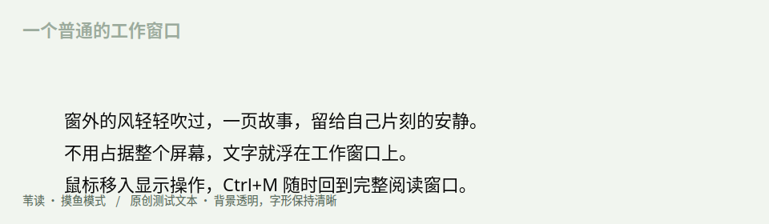

# 微信读书

苇读 0.2.0 新增微信读书官方网页版窗口。它使用 Qt WebEngine 直接访问 `https://weread.qq.com/`，适用于 Linux；微信扫码、书架、正文渲染和跨设备进度均由官网提供。

## 开始阅读

1. 打开苇读，在左侧点击 **微信读书**；也可以运行 `reed-reader --weread`。
2. 在官方页面点击 **登录**，用手机微信扫一扫完成授权。无需向苇读粘贴 Cookie 或密码。
3. 在官方书架选择小说；也可以在顶部地址栏粘贴 `https://weread.qq.com/web/reader/...` 书籍链接。
4. 使用官网目录、字体、阅读模式等控件阅读。可读范围与自己的微信读书账号、会员或已购权限一致。
5. 右上角 **摸鱼模式** 将当前已显示的正文变为默认 840×130 的透明阅读条，移除应用和网站工具栏。鼠标移入显示操作按钮，拖动顶部细边移动，右下角调整大小；**Ctrl+M** 返回完整窗口。官网需使用“上下滚动阅读”模式。

## 桌面操作

- **Alt+V**：显示/隐藏最后激活的阅读窗口（本地阅读器或微信读书）。
- **F8 / Ctrl+Alt+H / 鼠标中键**：立即隐藏苇读全部窗口，重复触发仍保持隐藏。托盘、Alt+V、`reed-reader --show` 可恢复。
- **Ctrl+M**：切换透明阅读条；**F11**：全屏；**Esc**：退出全屏，否则隐藏窗口。
- **Ctrl+R**：刷新；**Ctrl+L**：选择地址栏。
- **Alt+Z / Alt+C**：完整窗口发送 PageUp / PageDown；摸鱼模式每次滚动约 3/4 窄条高度，在章尾仅触发官网明确标为“下一章/下一页”的按钮。隐藏状态不发送滚动操作。
- 完整窗口底部可以设置置顶、整体透明度和 50%–200% 页面缩放。摸鱼模式始终置顶、不占任务栏，整体透明度固定为 100%，通过“设置”菜单独立调整背景/文字不透明度，并选择深色或浅色文字；鼠标离开后控制条隐藏。
- **浏览器打开**：在系统默认浏览器打开官网或当前书籍。两个浏览器的登录会话独立，可能需要再扫码一次。

键盘快捷键和鼠标中键在 X11 上全局生效；中键观察不拦截其他应用的原有操作，设置可关闭全局中键。应用内中键始终有效。Wayland 请在桌面设置中绑定 `reed-reader --toggle / --hide / --next / --previous / --mini`。网页窗口不依赖主书架窗口的可见性。

## 登录与本地数据

登录使用独立的 Chromium profile，路径为 `${XDG_DATA_HOME:-~/.local/share}/reed-reader/weread/profile`；网页缓存位于同级 `cache`，浏览器 HTTP 缓存上限 128 MiB。目录权限为仅当前用户可访问。默认保留网站登录会话，下次启动能否直接登录仍受微信读书登录有效期影响。

**清除登录** 会先关闭该网页配置，切换到新的独立 profile，再删除旧 profile 的 Cookie、Local Storage 和缓存，避免浏览器退出时的延迟写入恢复旧登录。新目录使用 `profile-<随机标识>` 与 `cache-<随机标识>`。操作前有确认框，不影响系统浏览器、手机账号或本地图书。退出苇读时会正确释放网页与 profile；可用 `reed-reader --quit` 正常退出。

苇读自身的设置 JSON 只保存窗口状态、缩放和不带查询参数的书籍路径，不保存 OAuth 参数或登录 Cookie。配置分享不包含上述本机字段。网站自身仍会按普通浏览器方式保存其会话和使用数据。

## 支持边界

- 这是官方网页阅读模式，不是微信读书私有 API 或电子书下载接口。不会将网页正文导出为 TXT/EPUB，也不会把网页藏书复制进本地 SQLite 书架。
- 会员、购买、试读范围及登录验证由官网决定。苇读不替代这些服务。
- 摸鱼模式仍使用官网已渲染的透明 Canvas 正文，应用可撤销的 CSS 隐藏导航、占位块和标题间距，去除外围背景并调整已绘制字形的颜色/透明度。它不将隐藏源节点显示出来，也不解码或导出 Canvas 正文。只有已显示正文的滚动阅读页可进入；登录、书架或其他页面保持完整窗口。
- 不关闭 Chromium 沙箱，不忽略证书错误，不伪造浏览器 UA。呈现适配仅用于官方阅读页，并可通过 Ctrl+M 撤销；网页自己的网络资源、访问权限和登录由官网处理。
- 原生窗口主导航只接受微信读书和微信 OAuth 官方 HTTPS 域名。其他网站链接提示使用系统浏览器。
- 如果官网调整兼容性或拒绝嵌入式浏览器，使用“浏览器打开”；外部浏览器窗口不受苇读隐藏键控制。

## 验证

- 36 项新增自动化用例使用原创本地 HTML 与临时 profile，覆盖 URL 验证、会话数据保留/清除、缩放/透明度、小窗、页面滚动、最后激活窗口的快捷键路由等。
- 现有 39 项测试仍通过，总计 **68 passed**。
- `QT_QPA_PLATFORM=xcb uv run python scripts/verify_weread.py` 对未登录官网进行真实 X11 检查：加载、登录入口、完整窗口透明度和显隐恢复通过，见 `weread-verification.json`。
- 另行原型检查确认微信登录二维码可在此内核显示。登录后的私人书架、小说权限和手机进度同步需要用户扫码后实测；没有用模拟结果替代真实账号验证。

## 来源

- 官方首页：https://weread.qq.com/
- 官方书架：https://weread.qq.com/web/shelf
- Qt WebEngine profile：https://doc.qt.io/qtforpython-6/PySide6/QtWebEngineCore/QWebEngineProfile.html
- Qt WebEngine page：https://doc.qt.io/qtforpython-6/PySide6/QtWebEngineCore/QWebEnginePage.html

## 透明阅读条的实际验证

用户已自行登录并打开小说。根据该授权会话检查可见的渲染结构，确认正文 Canvas 透明；实际修复了导航占位块和章节标题造成的 157px 顶部留白。实机画面中，窗口外框/导航/深色背景均已消失，文字直接叠加在桌面上。没有记录书籍正文、Cookie 或账号信息到仓库。

`QT_QPA_PLATFORM=xcb uv run python scripts/verify_weread_fish.py` 使用原创测试文字，验证透明像素、非空字形像素、840×130 尺寸、无工具栏和返回完整窗口，避免仅检查尺寸却交付空白窗口。结果见 `weread-fish-visual.json`。下图为原创测试文字的效果，而非用户小说截图：

官网 DOM/CSS 改版可能影响呈现适配；没有找到可见正文或处于横向分页模式时，会保留完整窗口并给出提示。模式切换会按章节滚动比例尽量保留位置；网页重排后可能有少量行位置变化。
